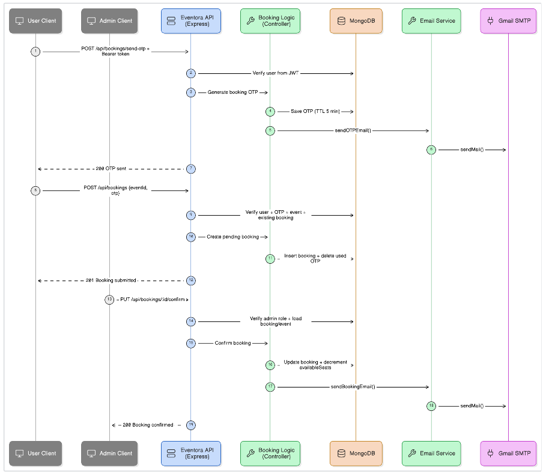
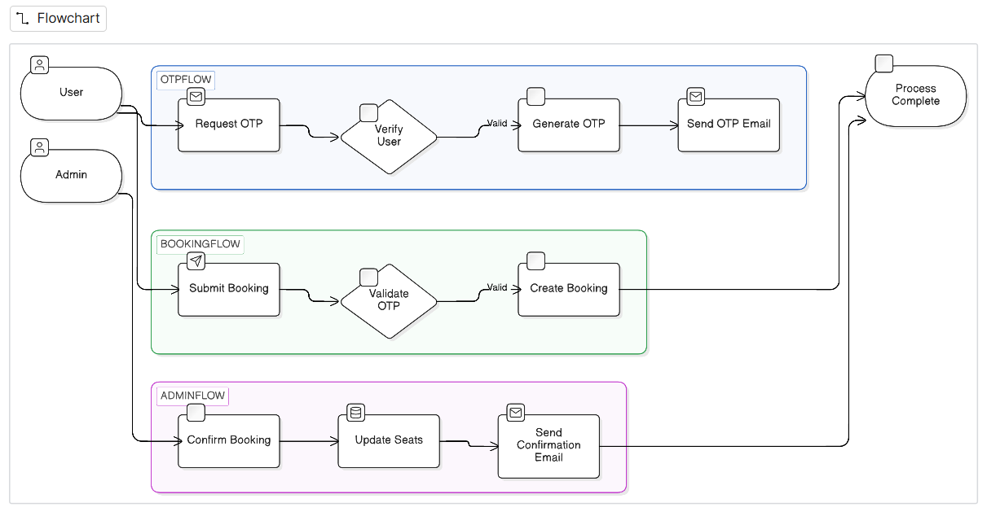

<h1 align="center">Eventora</h1>
<p align="center"><strong>Full-stack event discovery and booking management</strong></p>
<p align="center">A MERN application for event listings, verified booking requests, and administrator review.</p>
<p align="center"><a href="https://eventora-n1ou.onrender.com"></a></p>

<p align="center">
   
   
   
   
   
</p>

<p align="center">
   <a href="#overview">Overview</a> ·
   <a href="#features">Features</a> ·
   <a href="#workflow">Workflow</a> ·
   <a href="#run-locally">Run locally</a> ·
   <a href="#deploy-to-render">Deploy</a>
</p>

Eventora is a full-stack JavaScript project for discovering events and managing ticket requests. I built the booking flow to connect account verification, event discovery, OTP-confirmed requests, and admin review in one application.

## Overview

The React single-page application communicates with an Express REST API backed by MongoDB. Users browse and search listings, submit a verified booking request, and manage their bookings. Admins manage events, review requests, record payment status, and monitor booking totals.

**Booking flow:** Register and verify by email OTP → browse or search events → verify a booking request with OTP → admin approves or rejects it → user checks the result in the dashboard.

## Features

- **Account security:** Password hashing with bcrypt, JWT authentication, five-minute OTP records, and verified account registration.
- **Role-based authorization:** Express middleware protects administrator event and booking operations; roles are read from MongoDB.
- **Event CRUD:** Create, edit, and delete listings with dates, categories, locations, images, prices, and seat capacity.
- **Booking lifecycle:** OTP-confirmed requests, duplicate-request prevention, admin approval or rejection, cancellation reasons, and seat availability updates.
- **User and admin dashboards:** Booking status for users; event management, booking review, and paid-revenue totals for admins.
- **Email notifications:** Nodemailer sends OTP and booking status messages. Local development prints OTPs in the server terminal when email is not configured.
- **Single-service deployment:** Render serves the production React build and Express API from one web service.

> [!NOTE]
> Eventora records payment status manually. It does not accept payments or integrate a payment gateway; the payment result routes are informational.

## Technology

| Area | Tools |
| --- | --- |
| Frontend | React, React Router, Vite, Tailwind CSS, Axios |
| Backend | Node.js, Express |
| Data | MongoDB, Mongoose |
| Authentication | JWT, bcryptjs, time-limited email OTPs |
| Email | Nodemailer |
| Quality checks | Node.js test runner, ESLint, Vite production build |
| Hosting | Render Blueprint (`render.yaml`) |

The client and server use JavaScript. npm workspaces coordinate installation and scripts through one root lockfile.

## Repository Layout

```text
client/       React application and Vite configuration
server/       Express API, MongoDB models, controllers, and tests
render.yaml   Single-service Render deployment configuration
```

## Workflow

The sequence diagram shows how the client, API, database, and email service participate in booking. The flowchart summarizes the user and admin decisions.





## Engineering Highlights

- Centralized REST endpoints for authentication, events, and bookings.
- Database-backed authorization and booking state rather than client-only permissions.
- Cryptographically generated OTPs with five-minute database expiration.
- Literal, bounded event search input to avoid treating user text as a regular expression.
- Tests for booking status, event defaults, and security/media helpers.

## Run Locally

Requirements: Node.js 20 or newer and a reachable MongoDB database. MongoDB Atlas or a local MongoDB server can be used.

1. Copy the environment template:

   ```powershell
   Copy-Item server/.env.example server/.env
   ```

2. Edit `server/.env`. Set `MONGO_URI` to your database connection string and replace the sample `JWT_SECRET` with a private random value. Set `EMAIL_USER` and `EMAIL_PASS` to enable email delivery; otherwise development OTPs appear in the server terminal.
3. From the project root, install and start both applications:

   ```sh
   npm install
   npm run dev
   ```

Open `http://localhost:5173`. Vite proxies `/api` requests to Express on port `5000`. The server waits for MongoDB before accepting requests.

### Create the First Admin

Public registration creates standard user accounts only. To create the first admin locally, set `ADMIN_EMAIL` and a private `ADMIN_PASSWORD` of at least 12 characters in your shell, then run:

```sh
npm run admin:create --workspace server
```

The command refuses to create an admin if one already exists. Remove the temporary shell variables afterward. Never commit credentials or put them in this README.

### Project Commands

| Command | Description |
| --- | --- |
| `npm run dev` | Start the API and Vite client together |
| `npm test` | Run the server test suite |
| `npm run lint` | Lint client source |
| `npm run build` | Build the client for production |
| `npm start` | Start the Express production server; build the client first |
| `npm run seed --workspace server` | Replace local database contents with demo data; never use on production data |

## API Overview

All endpoints are prefixed with `/api`.

| Area | Routes | Access |
| --- | --- | --- |
| Authentication | `/auth/register`, `/auth/login`, `/auth/verify-otp` | Public |
| Events | `GET /events`, `GET /events/:id` | Public |
| Event management | `POST /events`, `PUT /events/:id`, `DELETE /events/:id` | Admin |
| Bookings | `POST /bookings/send-otp`, `POST /bookings`, `GET /bookings/my`, `DELETE /bookings/:id` | Authenticated |
| Booking review | `PUT /bookings/:id/confirm` | Admin |
| Health | `GET /health` | Public; reports API and database readiness |

## Deploy to Render

**Live application:** [https://eventora-n1ou.onrender.com](https://eventora-n1ou.onrender.com). The Render Web Service serves the production React client and API from one URL. The free instance may sleep when idle, so its first request can take longer to respond.

Render stores the production `MONGO_URI`, `EMAIL_USER`, `EMAIL_PASS`, and generated `JWT_SECRET`. To create an admin on a fresh database, use a trusted local checkout configured to the same database, set `ADMIN_EMAIL` and `ADMIN_PASSWORD` in the local shell, and run `npm run admin:create --workspace server`. The free Render plan does not provide the Shell workflow described by paid plans. See [SETUP_GUIDE.md](SETUP_GUIDE.md) for details.

## Contact

Project repository: [github.com/Ankitprajapati790/eventora](https://github.com/Ankitprajapati790/eventora)
